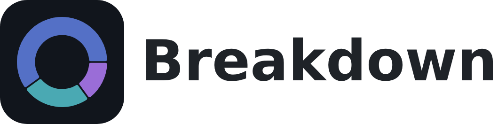
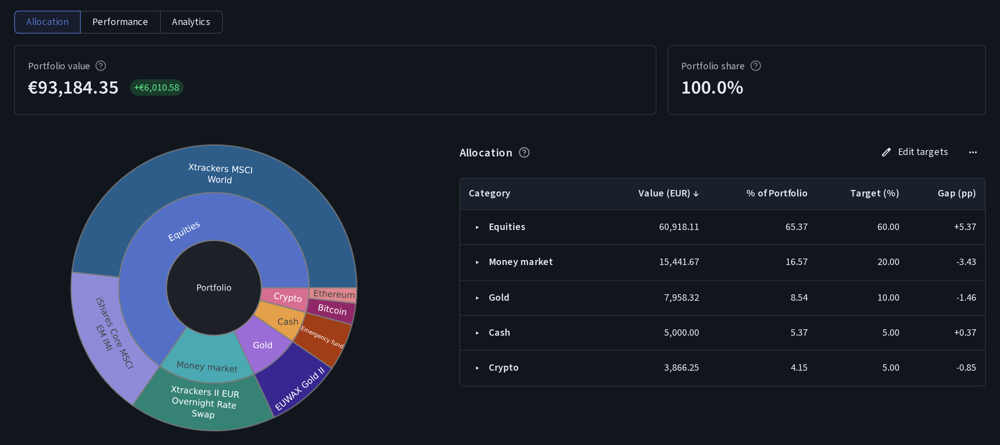

<picture>
  <source media="(prefers-color-scheme: dark)" srcset="docs/assets/readme-brand-dark.png" />
  
</picture>

---

A local portfolio-tracking and analysis app for understanding what you own,
which companies your ETFs actually expose you to, and whether your money is
allocated as planned. All portfolio data is stored locally on your computer.



*Allocation view of the offline demo portfolio. Holdings and prices are synthetic.*

## What this app can do

This app is designed to help you understand your current holdings, analyze
the underlying exposure of your ETFs, and inform rebalancing decisions. Its
key features are:
- Track stocks, ETFs, crypto, and physical assets in EUR, USD, or GBP using public market quotes or manually entered prices.
- Break down supported ETFs into their underlying holdings, combining direct and indirect exposure (e.g., NVIDIA shares held directly and through an MSCI World ETF).
- Analyze portfolio exposure by theme, sector, and geography.
- Group assets into categories and optionally define target allocations (e.g., 60% equities / 40% bonds).
- Set targets for individual assets within categories (e.g., 70% MSCI World / 30% MSCI EM within equities).
- Examine portfolio beta, annualized volatility, and correlations between assets.
- Set in-app alerts for moving averages, loan-to-value ratios or maintenance headroom.

You can track your current holdings on their own or add past transactions.
With transaction data, you can see what your portfolio was worth over time,
how much you added or withdrew, and how your investments performed. Missing
history is never reconstructed automatically. The app also provides
[Vorabpauschale estimates](docs/user/taxes.md) for supported fund years. It
does not connect to brokerage accounts or execute trades. Automatic ETF
breakdowns are limited to supported providers, and underlying holdings data
may be missing or incomplete.

## How to use

### Install a release

Choose a package for your operating system from the [GitHub releases page](https://github.com/eliaskempf/portfolio-breakdown/releases/latest).
Prebuilt packages include Python.

- **Windows x64** — Run the installer ending in `windows-x64-setup.exe`, then open **Portfolio Breakdown** from the Start menu. Setup installations can download and verify updates through **App menu → Help**.
- **Linux (Ubuntu 22.04/24.04, x64)** — Install the `.deb`, then open **Portfolio Breakdown Experimental** from the applications menu.
- **macOS (experimental, Apple Silicon, macOS 15+)** — When the release includes a `.dmg`, open it and drag **Portfolio Breakdown Experimental** into **Applications**. The app lacks Developer ID signing and notarization, so Gatekeeper may block it.

Portable packages are also available for Windows (`.zip`) and Linux (`.tar.gz`).
For platform-specific instructions, known limitations and uninstallation, see the
[installation guide](docs/user/install.md).

### Run from source

If you prefer to run the app from source or want to contribute to development,
install [uv](https://docs.astral.sh/uv/getting-started/installation/) and run:

```sh
git clone https://github.com/eliaskempf/portfolio-breakdown.git
cd portfolio-breakdown
uv sync --locked
uv run portfolio-app
```

`uv` automatically manages Python and the project environment.

On Windows, use `uv run portfolio-desktop` to launch the standalone window.
To explore 30 months of invented holdings and trades, run `uv run portfolio-app --demo`
for public market data or `uv run portfolio-app --demo --offline-demo` for synthetic prices.

### Documentation

Follow the [getting-started guide](docs/user/getting-started.md) or take the optional in-app tour.
The [user guide](docs/user/index.md) covers imports, calculations, backups and troubleshooting.
Installed packages include an offline copy under **App menu → Help → User guide**.

## Disclaimer

Portfolio Breakdown is a portfolio analysis tool, not investment advice. Market data,
ETF holdings, classifications, and calculations may be delayed, incomplete, or inaccurate.
Always verify important information independently before making investment decisions.

[GPL-3.0-only](LICENSE).
