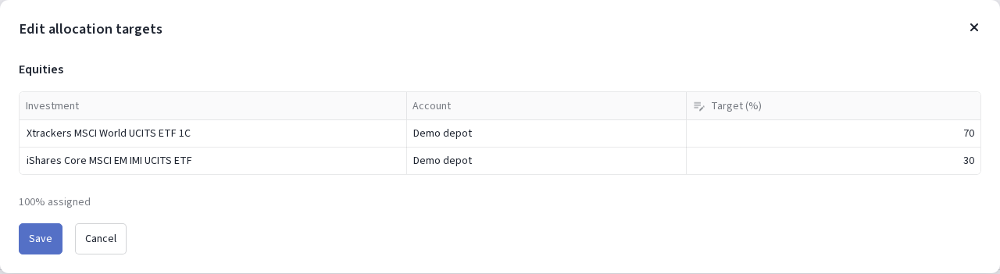

# Categories and targets {#categories}

## Build the strategic tree {#targets}

Open **Rebalance → Targets**. In an older workspace, review the preview for
enabling strategic allocation before saving. The app preserves legacy target
cells; it does not infer a global plan from current market values.

Add categories, save them, then use saved categories as parents. Assign each
position to one category. A category can contain both investments and subcategories. Unassigned positions stay visible. Review and save
category edits and position targets separately; **Discard changes** abandons a
draft. Move child categories and positions before deleting their parent.

Category targets are percentages of their **parent**. A position target is a
percentage of its **own category**. Global targets multiply these fractions.
For example, in an invented plan a category targeting 40% of the portfolio and a
position targeting 25% within it imply a 10% portfolio target. Under **Member targets**, immediate subcategory and investment
targets together must be complete and sum to 100%; the app does not silently normalize
saved targets. Blank means unknown, while zero is an explicit target.

[](assets/demo-targets.png)

*Synthetic offline example: 60% for Equities × 70% for its World ETF gives a 42%
portfolio target. The two grids use different denominators. Save categories and
Save position targets commit their respective edits separately. These percentages
illustrate the controls, not a recommended allocation. Open the image for detail.*

Moving a position preserves its within-category target. Check the destination's
total after moving it. Zero-quantity positions can carry nonzero targets for
future investments. Empty categories retain their targets without artificial
chart area.

## Flexible categories

Use **Create category from selection** to combine investments sharing one parent.
Review the name and combined target before saving. A complete set of existing
member targets supplies the initial combined target; otherwise it stays blank.
The investments retain their quantities, costs and histories.

A category containing investments directly can use **Flexible** internal
allocation. Only its combined target matters; differing member weights do not
trigger internal rebalancing. Set **Buy priority** and **Sell priority** separately,
using rank 1 for the first choice. Before planning a direction, rank every member
or leave all ranks blank until ready. A single member needs no ordering.

Open **Internal allocation settings** in an existing workspace to adopt this
editor. After adoption, **Allocation category** shows child categories and directly
owned investments in one target table. **Category structure** contains naming,
parent and sale-protection controls. **Assign positions** moves investments;
review the destination targets after moving. To dissolve a category, move its
positions out, then delete the empty category.

Switching to Flexible preserves saved member target numbers but stops using them.
Switching back to **Member targets** requires reviewing a complete 100% split.
Those numbers may have had a different denominator before the category was created.
Categories containing subcategories use Member targets.

## Read the Overview {#overview}

Select a category to focus its chart, allocation table and positions. Current
and target percentages use the selected category as their denominator. Back,
the category selector, or the chart center returns to a parent. Parent rows
include descendants: adding parent and child values double-counts them.
Missing prices suppress complete percentages; the chart represents known value.
Exposure filters and ETF expansion do not alter strategic ownership.

The allocation table shows immediate subcategories alongside directly owned investments.
Category rows start collapsed. Open a row's chevron to reveal its investments
and subcategories, slightly indented beneath the combined value and target.
Closed positions are hidden in expanded and flattened groups unless **Show sold positions** is enabled in Portfolio settings. Their history and targets remain retained. Account subtitles are prefixed **Account:** to distinguish them from category ownership.
Expansion changes only the table; the chart, selection and percentage denominator
stay unchanged. Sorting keeps members beneath their category. Click an investment
to open its details. Member rows are included in their parent totals, not additional
allocation. Flexible members have blank targets; explicit member targets are
expressed as percentages of the selected scope.
For sorting across groups, open the **⋯ Table options** menu beside the table heading
and enable **Flatten groups**. This lists all source positions in the selected scope,
including descendant categories. Only the table changes; the chart keeps its hierarchy.
The option is remembered per workspace. Account rows remain distinct, and the selection,
percentage denominator and allocation measure stay unchanged. This does not expand ETFs.

Explicit investment targets multiply through the category path into the selected
scope. Members of flexible categories have no individual target or gap. The flat
table identifies their owning category; navigate there or turn off Flatten groups
to inspect the shared target.

With leverage enabled, **Market exposure** is the first and default allocation
view in Overview. It shows current exposure value, current share, target share and **Gap (pp)**, where
positive means overweight (current minus target). **Capital allocation** remains
available with its own capital targets; exposure targets are not cash targets.
When no separate exposure policy is saved, Market exposure compares against your
existing category and position target percentages. For example, 35% current
exposure against a 40% target gives a −5 pp gap. This composition comparison
requires no target leverage multiple and does not create target currency amounts
or change saved percentages. A separately saved market-exposure policy takes
precedence; an equity-only or invalid policy is not replaced by this fallback.
Use **Edit** beside either table heading for a compact editor of the selected
category’s target percentages. The split must total 100%; **Save** applies it and
**Cancel** discards it. A group with one shared target opens its parent’s split.
At Portfolio scope, a saved exposure policy also offers its total exposure
multiple. **Manage targets** opens the full configuration for policy settings,
category structure and member priorities.
Hover over the heading for its measure definition. Exposure targets are a separate policy under
**Rebalance → Targets → Exposure targets**: choose a desired total multiple of
portfolio net equity and category composition. Capital targets stay unchanged.

Target amounts always use the saved whole-portfolio policy. Within a selected
category, current percentages divide by its current exposure, and target
percentages divide by its desired exposure. The Overview gap is the difference
between these displayed percentages. Monetary exposure gaps in Rebalance remain
target minus current exposure; they are not cash purchase budgets. Signed exposures stay
signed, and percentages are unavailable when their total is zero or negative.
For a separate saved exposure policy, combined category targets do not imply individual
position targets. Those members remain blank in expanded and flat views. Explicit
investment exposure targets appear in both views, expressed in the selected scope.

Choose **Categories and investments within each parent** in the exposure target editor
to assign targets to subcategories and directly owned investments side by side.
Their shares must total 100% within each parent. Flexible categories retain one combined
exposure target. For other categories without subcategories, **Categories with individual
exposure targets** optionally enables a member split. Exposure targets remain independent
of capital targets; changing a chart measure does not activate a planning policy.

Existing leaf and category-only policies retain their saved meaning. If grouping or moving
positions makes one invalid, select the mixed convention and explicitly save the new
split in the editor. No targets are silently redistributed. Moved, missing or newly added
investments in a scope with individual targets require review, including zero balances.
A saved equity-only policy is labeled as
such and is not compared against the broader Market exposure view. Switching its
universe to Total market requires an explicit save in the exposure target editor.

Data-coverage details appear when hovering over category names. Unassigned means
no strategic category is assigned; an empty zero-value/zero-exposure row is hidden.
Offsetting long and short exposures remain represented even if their net is zero.
The **Notifications** bell beside **Portfolio settings** holds stale ETF snapshots, manual-price notices,
valuation/performance gaps and refresh problems. Tooltips explain metrics and
table columns without adding paragraphs to the overview.
A dot marks unread notices. Opening the panel marks current notices as seen;
new, changed or recurring notices light it again. Seen state is separate per
portfolio for the current browser session; notices remain available after reading.

## Analytical labels are separate {#classifications}

Strategic categories are a non-overlapping ownership tree. Analytical taxonomies
can describe several aspects of the same asset, such as sector, theme and
geography. Edit `classifications.yaml` in the private workspace for these labels.
Back it up first and preserve asset IDs. An invented example for an instrument
whose ID is `example-company`:

```yaml
example-company:
  classifications:
    sector:
      - [Industry, Example services]
    theme:
      - [Example theme, Example activity]
```

Taxonomy names and depths are flexible. An asset assigned to several distinct
paths splits its value equally among them; repeated identical paths are ignored.
Full paths distinguish identically named nodes under different parents. Missing
membership becomes **Unclassified**. An **Assigned here** chart leaf preserves
value attached directly to an internal node. An empty file mapping `{}` is valid.

Legacy workspaces without strategic allocation use whole-portfolio position
targets in `target_allocation`. Filtered legacy targets retain their original
portfolio basis. Review migration in Targets before relying on category-relative
planning. See [Exposure](exposure.md#filters) for analytical filtering.
